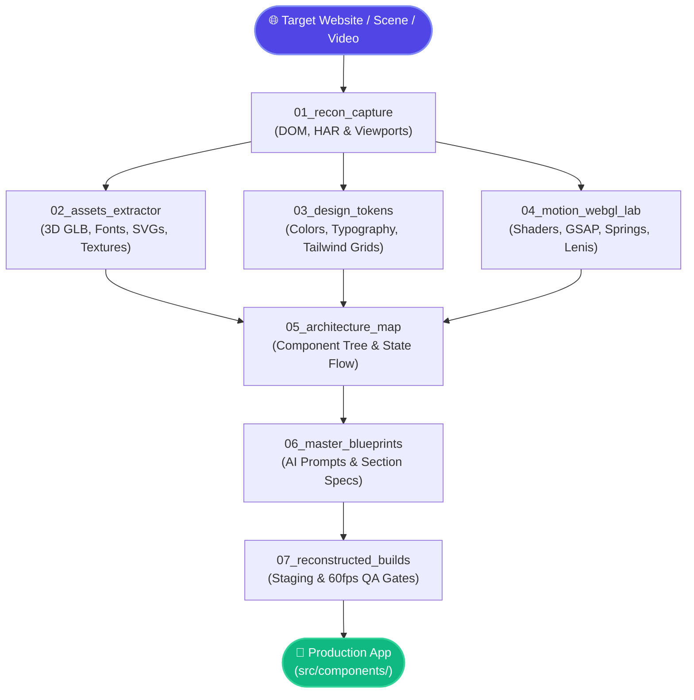

# 🎛️ REA CONTROL CENTER (Reverse Engineering Anything)

> **Principal Reverse Engineering Systems Architect Dashboard**  
> *A unified, end-to-end framework for deconstructing, reverse-engineering, and reconstructing high-end websites, 3D WebGL scenes, design systems, and fluid animations.*

---

## 🏗️ The 7-Folder REA Pipeline Architecture



---

## 📂 7-Folder Directory Map & Manifest

| # | Folder Name | Primary Mission | Key Deliverables & Scripts |
| :---: | :--- | :--- | :--- |
| **01** | `01_recon_capture/` | Capture raw ground truth | `capture-dom.mjs`, `target-manifest.json`, `captured-dom.html` |
| **02** | `02_assets_extractor/` | Extract models, fonts & SVGs | `extract-assets.mjs`, `asset-inventory.json`, `models/`, `fonts/`, `svgs/`, `textures/` |
| **03** | `03_design_tokens/` | Decompile exact design system | `tokens-schema.json`, `tailwind-mapper.md` |
| **04** | `04_motion_webgl_lab/` | Deconstruct 3D WebGL & motion | `shader-template.glsl`, `motion-curves.json`, `webgl-deconstruction-guide.md` |
| **05** | `05_architecture_map/` | Map state and component logic | `component-tree-template.md`, `data-flow-schema.json` |
| **06** | `06_master_blueprints/` | Generate bug-free AI prompts | `MASTER_RECONSTRUCTION_PROMPT.md`, `section-spec-template.md` |
| **07** | `07_reconstructed_builds/` | Staging & 60 FPS QA checklist | `qa-verification-checklist.md`, `build-registry.json`, `staging/` |

---

## ⚡ Quick-Start: How to Reverse-Engineer Any Target

### Option A: You Have a Target Website URL
1. **Initialize the Pipeline:**
   ```bash
   node REA/rea-cli.mjs recon "https://target-site.com"
   ```
   *Automatically runs Phase 01 DOM capture and logs page metadata.*

2. **Extract Assets:**
   ```bash
   node REA/rea-cli.mjs extract --download
   ```
   *Extracts vector SVGs, 3D model links, and custom fonts into Phase 02.*

3. **Generate Master AI Prompt:**
   Open `REA/06_master_blueprints/MASTER_RECONSTRUCTION_PROMPT.md`, customize your component target, and paste it to Antigravity!

---

### Option B: You Have a Video or Screenshot
1. Place your reference video or screenshot into `REA/01_recon_capture/`.
2. Inspect the motion timing using `REA/04_motion_webgl_lab/motion-curves.json` to identify matching spring curves or GSAP durations.
3. Extract color palette and fonts into `REA/03_design_tokens/tokens-schema.json`.
4. Trigger the master reconstruction prompt in Phase 06.

---

## 🛠️ CLI Runner Command Cheat Sheet (`rea-cli.mjs`)

The `rea-cli.mjs` script is self-contained with **zero external dependencies** (runs on native Node 22):

```bash
# 1. Audit all 7 REA folders for completeness
node REA/rea-cli.mjs audit

# 2. Run automated recon against a target URL
node REA/rea-cli.mjs recon https://example.com

# 3. Extract and catalog assets from captured DOM
node REA/rea-cli.mjs extract

# 4. Extract and download all remote assets
node REA/rea-cli.mjs extract --download

# 5. Check QA status and staged builds
node REA/rea-cli.mjs status

# 6. Show interactive help
node REA/rea-cli.mjs help
```

---

## 🛡️ Production Safety & TypeScript Isolation
- `REA/` is explicitly excluded from `tsconfig.json` (`"exclude": ["node_modules", "REA"]`), ensuring that experimentation, test scripts, and scratch files never block your production Next.js build.
- Every reconstructed component must pass `REA/07_reconstructed_builds/qa-verification-checklist.md` before being copied to `src/components/`.
