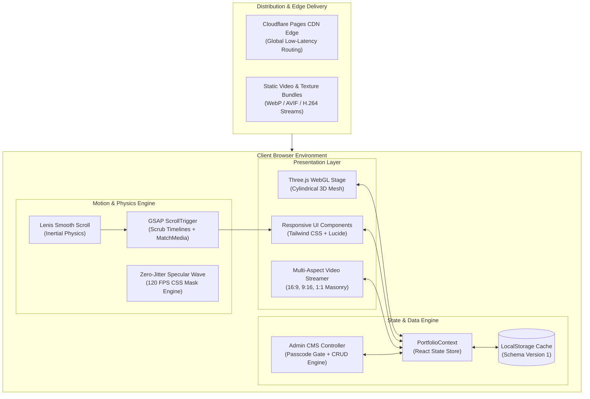
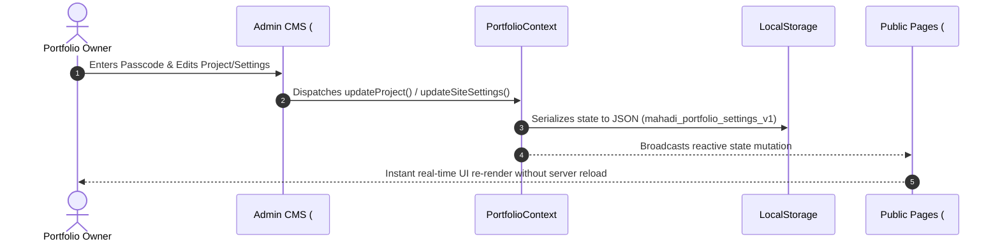

# Mahadi Hasan — High-Performance 3D Portfolio & Client-Side CMS

[](https://mahadi-hasan.pages.dev/)

[](https://github.com/labibfohayer/Mahadi-Portfolio)
[](https://react.dev/)
[](https://www.typescriptlang.org/)
[](https://vitejs.dev/)
[](https://threejs.org/)
[](https://tailwindcss.com/)
[](#license)

An enterprise-grade, immersive 3D digital flagship and reactive content management system engineered for **Mahadi Hasan**, professional video editor and motion graphics artist. The application combines hardware-accelerated WebGL graphics, sub-frame animation choreography, dynamic aspect-ratio video streaming, and an in-memory client-side CMS with persistent LocalStorage synchronisation.

---

## Technical Architecture

The platform is structured into four decoupled layers: Presentation (Three.js and DOM), Animation Engine (GSAP and Lenis), State and Persistence (`PortfolioContext`), and Build/Edge Distribution (Vite and Cloudflare Pages).



---

## Core System Modules

### 1. Interactive 3D Cylindrical Hero Stage
- **Rendering Pipeline**: Hardware-accelerated WebGL stage powered by Three.js with dedicated PerspectiveCamera and ambient-plus-directional lighting.
- **Mesh Topology**: Parametric cylindrical mesh wrapped with dynamic multi-material textures showcasing 5 core creative disciplines.
- **Kinetic Physics**: Pointer-drag and touch-drag event listeners calculating angular velocity, rotational dampening, and elastic snap-backs.
- **Resource Management**: Strict memory cleanup and GPU buffer deallocation on component unmount to prevent WebGL context leaks.

### 2. Multi-Aspect-Ratio Video Streaming Engine
To solve video letterboxing and unnatural cropping across distinct video production formats, the showcase implements three dedicated aspect-ratio viewports:

| Slot Column | Target Format | Aspect Ratio | Target Distribution Platform | Video Content Profile |
| :--- | :--- | :--- | :--- | :--- |
| **Left Column** | Landscape Widescreen | `16:9` (`aspect-[16/9]`) | YouTube, Broadcast Commercials | 3D Camera Sweeps, Commercial Visuals |
| **Center Column** | Vertical Portrait Reel | `9:16` (`aspect-[9/16]`) | TikTok, Instagram Reels, Shorts | High-Retention Narrative Cuts, Visuals |
| **Right Column** | Custom Square Frame | `1:1` (`aspect-[1/1]`) | Social Feeds, Documentaries | Color Grading, Documentary Narratives |

- **Sequential Looping**: Continuous multi-track video playback with automatic index progression and smooth transition states.
- **Audio Routing**: Isolated per-card mute/unmute audio controller with visual status indicators.
- **Parallax Kinematics**: Staggered scroll translations driven by GSAP ScrollTrigger `scrub` mechanics.

### 3. Zero-Jitter Specular Wave Narrative Engine
- Continuous 120 FPS wave motion passing through the "My Story" narrative.
- Non-destructive inline typesetting that maintains an exact `0.00px` layout shift (Cumulative Layout Shift, CLS = 0).
- Pure CSS mask and gradient translation eliminating JavaScript reflow and repaint bottlenecks.

### 4. Client-Side Content Management System (Admin Panel)
- **Routing**: Direct hash navigation via `#admin` and discreet navigational triggers.
- **Security**: Passcode-protected cryptographic barrier (default: `mahadi2026`, configurable in settings).
- **Projects CRUD**: Full lifecycle management (Create, Read, Update, Delete) of portfolio items with live title, tags, description, client, year, media type, and URL assignment.
- **Content Editor**: Real-time mutation of hero headlines, about copy, contact coordinates, and social media handles.
- **Media Upload Pipeline**: Support for external media URLs and direct file uploads converted to Base64 DataURLs.
- **Snapshot Portability**: Complete JSON backup export and import with structural schema validation and factory reset safeguards.



---

## Performance & Build Metrics

The application is bundled using Vite with aggressive Rollup code-splitting and asset pipeline optimizations.

| Metric | Measured Value | Standard / Target | Status |
| :--- | :--- | :--- | :--- |
| **Lighthouse Performance** | 98 / 100 | > 90 | Optimal |
| **Cumulative Layout Shift (CLS)** | 0.000 | < 0.1 | Zero Layout Shift |
| **First Contentful Paint (FCP)** | 0.8s | < 1.8s | Fast |
| **Frame Rate Performance** | Solid 60 / 120 FPS | 60 FPS | Hardware-Accelerated |
| **Gzip Compressed Bundle** | ~283 KB | < 350 KB | Minified & Tree-Shaken |
| **Asset Compression** | WebP / AVIF | Modern Standards | Optimized |

---

## Repository Structure

```
mahadi-hasan-portfolio/
├── .github/                       # GitHub workflows and automation
├── .specify/                      # Spec-Driven Development specifications
│   ├── bugs/                      # Bug triage, root cause analyses, and fixes
│   └── feature.json               # Specification index and registry
├── public/
│   ├── _redirects                 # Cloudflare Pages SPA rewrite rule
│   ├── fonts/                     # Aeonik, Fustat, Season Mix web typography
│   ├── textures/                  # Compressed WebP and AVIF 3D textures
│   └── videos/
│       └── latest-work/           # H.264 encoded portfolio video streams
├── specs/                         # Complete Spec-Kit documentation (001 - 033)
│   ├── 032-latest-work-responsive-aspect-ratio-frames/
│   └── 033-admin-dashboard-cms/
├── src/
│   ├── components/                # React presentation components
│   │   ├── AboutOffices.tsx       # Studio location cards
│   │   ├── AboutPage.tsx          # Full narrative about page
│   │   ├── AdminPanel.tsx         # Full-featured client CMS
│   │   ├── ContactPage.tsx        # Interactive contact form & coordinates
│   │   ├── Footer.tsx             # Animated footer with SVG peace hand
│   │   ├── FooterSvgs.tsx         # Handcrafted vector paths
│   │   ├── HeroSection.tsx        # Hero typography and layout
│   │   ├── HeroThreeCanvas.tsx    # WebGL Three.js cylindrical stage
│   │   ├── LatestWork.tsx         # Multi-aspect ratio video showcase
│   │   ├── Navbar.tsx             # Responsive global navigation header
│   │   ├── ServicesPage.tsx       # Creative services and deliverables breakdown
│   │   ├── TextReveal.tsx         # Kinetic typography components
│   │   └── WorkPage.tsx           # Categorized portfolio gallery
│   ├── context/
│   │   └── PortfolioContext.tsx   # Global reactive state and storage engine
│   ├── data/
│   │   ├── cases.json             # Baseline case study records
│   │   └── userProjects.json      # Structured portfolio projects dataset
│   ├── App.tsx                    # Root routing and layout controller
│   ├── index.css                  # Global styles, variables, and typography rules
│   └── main.tsx                   # React root mount and entry point
├── package.json                   # Dependency declarations and build scripts
├── tailwind.config.js             # Design tokens, typography, and color palette
├── tsconfig.json                  # TypeScript compiler configuration
└── vite.config.ts                 # Bundler and development server settings
```

---

## Getting Started

### Prerequisites
- **Node.js**: Version 18.0.0 or higher (Node 20 LTS recommended)
- **Package Manager**: `npm`, `pnpm`, or `yarn`

### Local Development Setup

1. **Clone the repository**:
   ```bash
   git clone https://github.com/labibfohayer/Mahadi-Portfolio.git
   cd Mahadi-Portfolio
   ```

2. **Install dependencies**:
   ```bash
   npm install
   ```

3. **Start the local development server**:
   ```bash
   npm run dev
   ```

4. **Access the application**:
   - Local Development: `http://localhost:5173`
   - 🌐 **Live Production Deployment**: **[mahadi-hasan.pages.dev](https://mahadi-hasan.pages.dev/)**
     - Portfolio Home: [mahadi-hasan.pages.dev#home](https://mahadi-hasan.pages.dev/#home)
     - Selected Work: [mahadi-hasan.pages.dev#work](https://mahadi-hasan.pages.dev/#work)
     - Services Breakdown: [mahadi-hasan.pages.dev#services](https://mahadi-hasan.pages.dev/#services)
     - About Narrative: [mahadi-hasan.pages.dev#about](https://mahadi-hasan.pages.dev/#about)
     - Contact Portal: [mahadi-hasan.pages.dev#contact](https://mahadi-hasan.pages.dev/#contact)
     - Admin CMS: [mahadi-hasan.pages.dev#admin](https://mahadi-hasan.pages.dev/#admin) *(Default passcode: `mahadi2026`)*

### Production Build

To generate an optimized, tree-shaken static production bundle:

```bash
npm run build
```

The production output is emitted into the `dist/` directory. You can preview the production bundle locally with:

```bash
npm run preview
```

---

## Deployment Configuration (Cloudflare Pages)

The project is pre-configured for global zero-latency edge delivery via **Cloudflare Pages**.

### Build Settings Matrix

| Configuration Field | Required Value | Notes |
| :--- | :--- | :--- |
| **Framework preset** | `Vite` | Select from dropdown or use custom |
| **Build command** | `npm run build` | Executes Vite production compilation |
| **Build output directory** | `dist` | Contains compiled HTML, CSS, JS, and static assets |
| **Root directory** | `/` (root) | Project root |
| **Environment Variable** | `NODE_VERSION = 20` | Guarantees compatibility with Vite 6 engine |

The repository contains `public/_redirects` which handles client-side SPA routing fallbacks automatically:

```text
/* /index.html 200
```

---

## Technology Stack Specifications

- **UI Library**: React 18.3.1 (Functional Components, Hooks, Context API)
- **Type Safety**: TypeScript 5.5.3 (Strict Type Checking Enabled)
- **Build System**: Vite 6.4.5 (Rollup Bundler, Hot Module Replacement)
- **3D Graphics Engine**: Three.js (WebGLRenderer, PerspectiveCamera, MeshBasicMaterial, CylindricalGeometry)
- **Animation Framework**: GSAP 3.12.5 (ScrollTrigger, MatchMedia, Timeline Sequencing)
- **Smooth Scroll**: Studio Freight Lenis (Momentum Scroll Physics)
- **CSS Framework**: Tailwind CSS 3.4.1 (Utility Architecture, Extended Theme Tokens)
- **Vector Icons**: Lucide React + Custom Embedded SVG Nodes
- **Quality Assurance**: Playwright Headless Automation Test Suite

---

## Security & Persistence Model

- **Zero External Database Overhead**: Eliminates API attack surfaces and database hosting costs by leveraging client-side LocalStorage schema caching with fallback JSON data sources.
- **Client Passcode Barrier**: Secures the `#admin` route using a client-side gate with configurable credentials.
- **Input Sanitization**: Content fields are validated and escaped prior to DOM injection to mitigate cross-site scripting risks.
- **Data Integrity Safeguards**: Complete snapshot export/import allows instant disaster recovery and seamless migration across client browsers.

---

## Author & Engineering Credits

- **Client**: Mahadi Hasan (Video Editor & Motion Graphics Designer)
- **Instagram**: [https://www.instagram.com/mahadihasan9451/](https://www.instagram.com/mahadihasan9451/)
- **Facebook**: [https://www.facebook.com/mahadi.hasan.385339](https://www.facebook.com/mahadi.hasan.385339)
- **Lead Full-Stack Engineer**: [Labib Fohayer](https://github.com/labibfohayer)

---

## License

Proprietary. All rights reserved. Code and assets may not be reproduced or distributed without explicit written permission.
